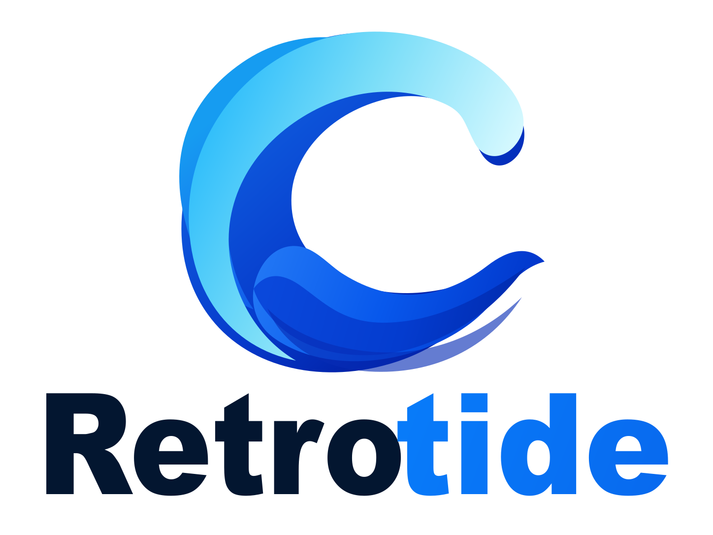

  <picture>
    <source media="(prefers-color-scheme: dark)" srcset="frontend/public/logo-dark.png">
    
  </picture>

# RetroTide

A sprint retrospective tool. Teams run a board of columns and cards, write cards, vote on them, talk them through, and carry the actions they agree into the next retro.

## Features

- Live boards with columns, cards, votes, comments, reactions, merging, sorting, and search
- Cards are hidden until the facilitator reveals them, so nobody reads anyone else's cards early
- Facilitation: write, vote and discuss phases, a timer with auto-lock, vote budgets, presentation mode and anonymous boards
- Action items that carry over into the team's next retro
- Organisations and teams, with invites and roles
- Guests join a board from a link, without an account
- About 40 built-in templates, plus saved team templates
- Surveys and health checks on a board
- Exports to CSV, Markdown, JSON, PDF, and PNG
- Sign in with email and password, Google or Microsoft, with optional two-factor authentication
- An admin console for site settings, users, and the audit log

## Self-hosting

Install steps and the compose file are at [retrotide.app/self-host](https://retrotide.app/self-host).

## Licence

Proprietary. All rights reserved; see [LICENCE](LICENSE).
